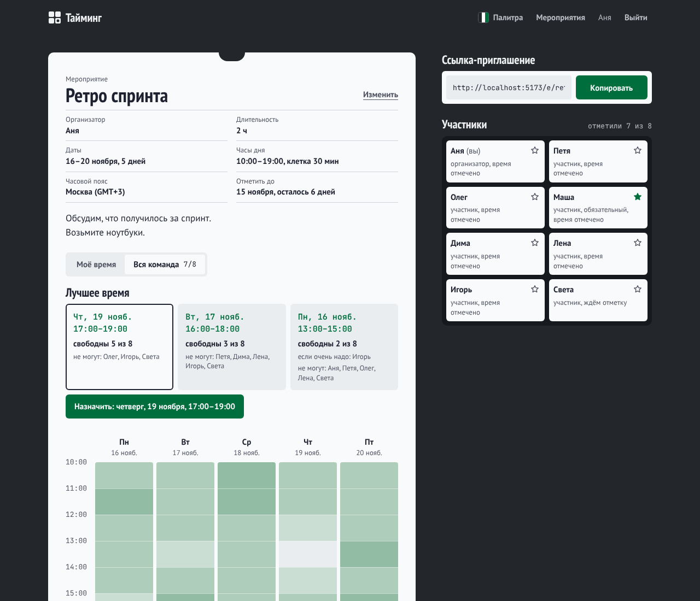
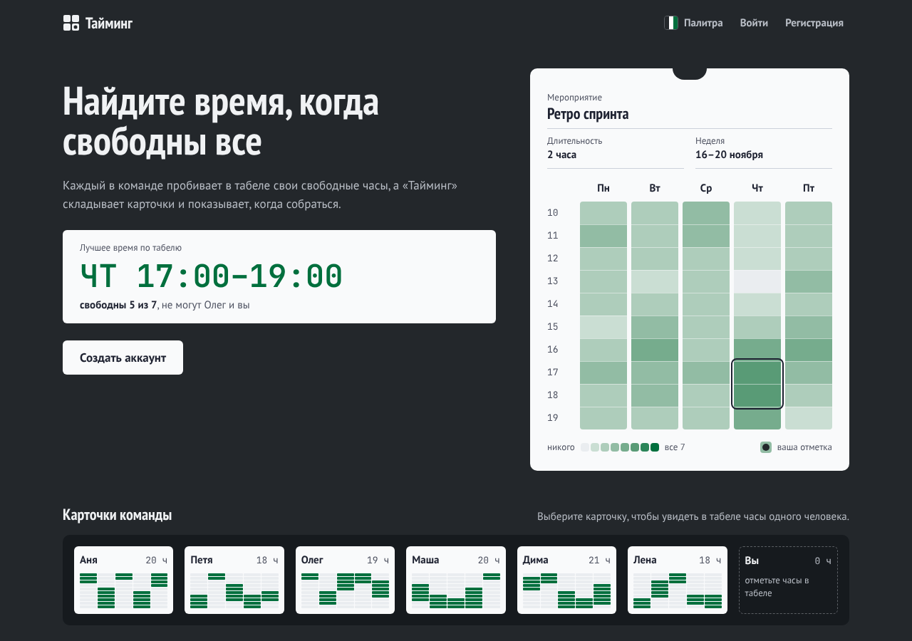
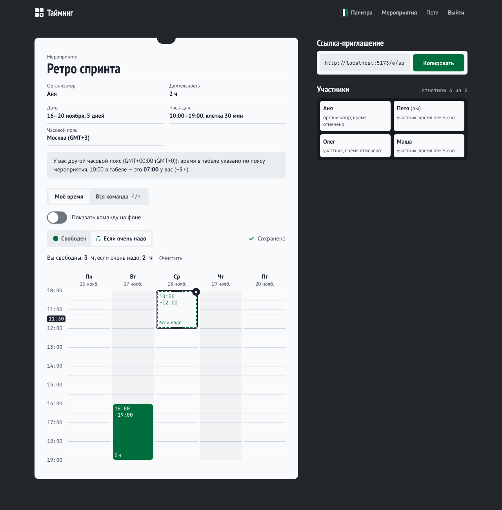
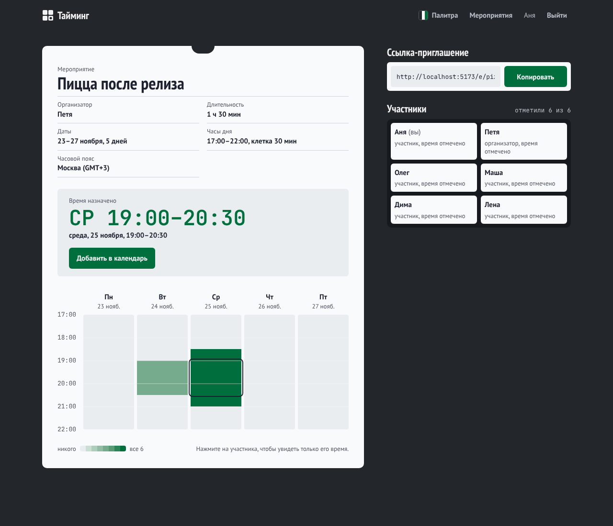
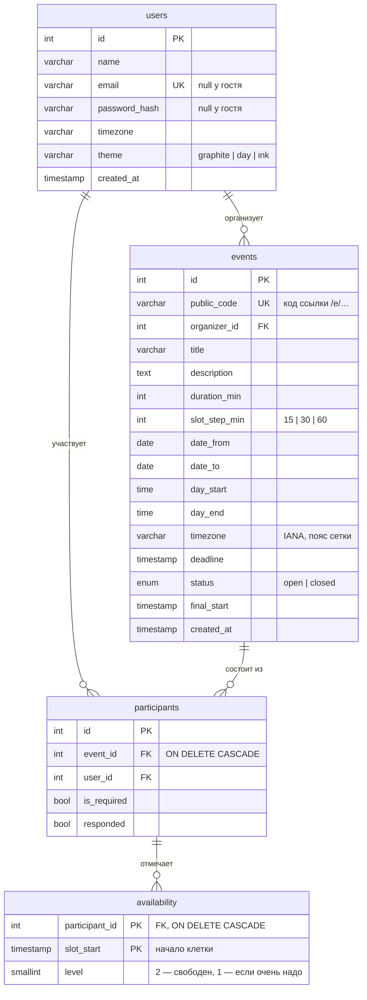
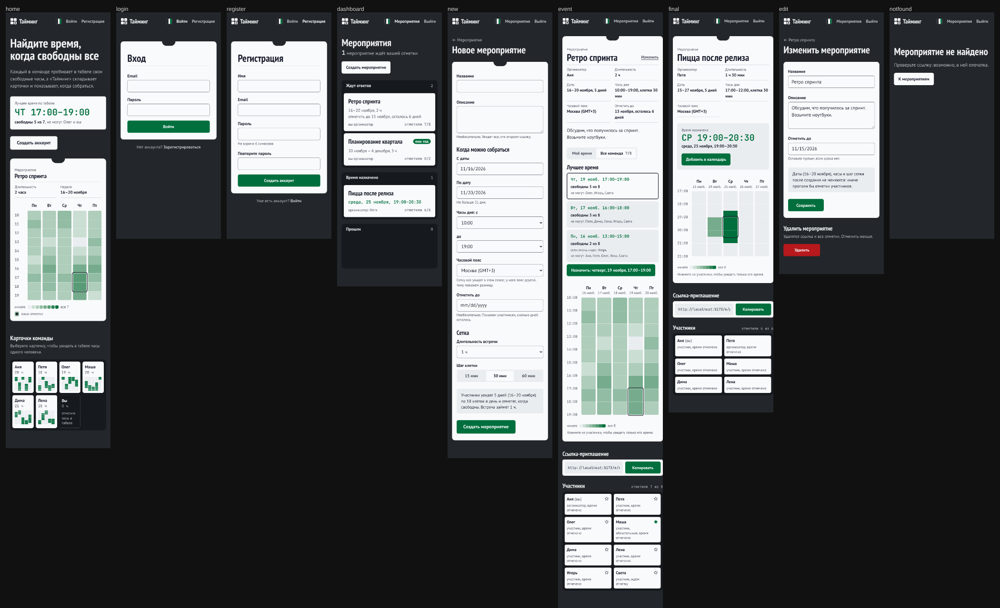

# Тайминг

Веб-приложение для планирования командных мероприятий. Организатор создаёт мероприятие и рассылает
ссылку, каждый участник отмечает на табеле свободные часы, приложение складывает отметки в тепловую
карту, подбирает лучшее время с учётом обязательных участников и назначает встречу.



| Главная с живым демо | Своё время: отрезки и «если очень надо» | Время назначено |
| --- | --- | --- |
|  |  |  |

## Возможности

- Регистрация и вход (JWT) или вход по ссылке только с именем.
- Мероприятия: диапазон дат, часы дня, шаг 15/30/60 минут, часовой пояс, срок отметки.
- Своя сетка-«ленты»: протягивание мышью, ручки отрезков, два касания на телефоне, клавиатура,
  уровень «если очень надо».
- Тепловая карта команды с подсказкой, кто может, и временем одного участника.
- Подбор лучшего окна с учётом обязательных участников; назначение и экспорт в календарь (`.ics`).
- Живые обновления через WebSocket, три палитры (сохраняются в профиле), адаптив до 320px.

## Стек

| Часть    | Технологии |
| -------- | ---------- |
| Фронтенд | React 19, TypeScript, Vite, Tailwind CSS 4, React Router, Socket.IO client; шрифты из npm (@fontsource) |
| Бэкенд   | Node.js 22, Express 5, TypeScript, Zod, Socket.IO, JWT, bcrypt |
| БД       | PostgreSQL 16, Prisma ORM (миграции) |
| Тесты    | Vitest (алгоритм, пояса, `.ics`), Playwright (8 сквозных сценариев) |
| Запуск   | Docker Compose (разработка и продакшен), OpenAPI/Swagger |

## Быстрый старт

```bash
docker compose up --build
```

```bash
docker compose exec server npm run db:seed:prod
```

- Приложение: http://localhost:5173 — войдите как `anya@demo.timing` / `demo123`
- Документация API: http://localhost:3000/api/docs
- Демо-мероприятия: `/e/retro234` (идёт выбор), `/e/pizza567` (время назначено), `/e/kvartal8` (только создано)

Сценарий показа для защиты — [docs/DEMO.md](docs/DEMO.md).

## Модель данных



`participants (event_id, user_id)` уникальны: присоединиться дважды нельзя. Отметки хранят только
отмеченные клетки; пустые клетки вычисляются из параметров мероприятия.

## Дизайн

Визуальная система описана в [DESIGN.md](DESIGN.md): направление «табель и табельные часы»,
три палитры на выбор пользователя (сохраняются в профиле),
шрифты (PT Sans Narrow, PT Sans, JetBrains Mono), цвета с измеренным контрастом, отступы,
радиусы, компоненты и анимация. Перед любой работой с интерфейсом прочитайте DESIGN.md и
берите значения оттуда; токены в коде — `client/src/index.css`.



## Структура

```
timing/
├── client/                    # фронтенд (React + Vite)
│   └── src/
│       ├── components/        # AvailabilityGrid, HeatmapGrid, TimeCard, ThemePicker, Button, Field…
│       ├── pages/             # главная, вход, кабинет, мероприятие, создание, правка
│       ├── lib/               # api, events, useAvailability, useHeatmap, useEventLive, tz, themes
│       ├── styles/            # interaction kit (отклик на нажатия)
│       └── index.css          # токены дизайна и палитры (Tailwind @theme)
├── server/                    # бэкенд (Express)
│   ├── prisma/                # schema.prisma и миграции
│   └── src/
│       ├── routes/            # auth.ts, events.ts
│       ├── lib/               # suggest (подбор времени), tz, ics, jwt — с unit-тестами
│       ├── realtime.ts        # Socket.IO
│       ├── openapi.ts         # описание API для Swagger
│       └── seed.ts            # демо-данные
├── e2e/                       # сквозные тесты Playwright
├── docs/                      # сценарий защиты, скриншоты
├── Dockerfile                 # продакшен-образ: API + собранный фронтенд
├── docker-compose.yml         # разработка
└── docker-compose.prod.yml    # продакшен
```

## Разработка без Docker

Нужны Node.js 22+ и PostgreSQL 16 (или только БД из Docker: `docker compose up db`).

```bash
cd server
cp .env.example .env
npm install
npm run db:migrate
npm run db:seed
npm run dev
```

В другом терминале:

```bash
cd client
npm install
npm run dev
```

Фронтенд проксирует `/api/*` и `/socket.io` на `http://localhost:3000`.

## Продакшен

Один контейнер отдаёт и API, и собранный фронтенд (`CLIENT_DIST`), миграции применяются при старте.
Рядом с `docker-compose.prod.yml` создайте `.env` со строкой `JWT_SECRET=<длинная случайная строка>`, затем:

```bash
docker compose -f docker-compose.prod.yml up --build -d
```

Приложение и API — http://localhost:8080. Демо-данные (по желанию):

```bash
docker compose -f docker-compose.prod.yml exec app npm run db:seed:prod
```

### Деплой на Render

1. **New → PostgreSQL** — создать базу, скопировать *Internal Database URL*.
2. **New → Web Service** из этого репозитория, *Runtime: Docker* (используется корневой `Dockerfile`).
3. Переменные окружения: `DATABASE_URL` — из шага 1, `JWT_SECRET` — длинная случайная строка,
   `CLIENT_URL` — адрес сервиса (`https://…onrender.com`, нужен для ссылок в `.ics`).
4. После первого деплоя (по желанию) в *Shell*: `npm run db:seed:prod`.

На Railway так же: сервис из репозитория (Dockerfile) + плагин PostgreSQL + те же переменные.

## API

Ответы — JSON. Ошибки приходят в виде `{ "error": "текст", "fields"?: { "поле": "текст" } }`.
Защищённые запросы требуют заголовок `Authorization: Bearer <token>`.

| Метод | Путь                 | Доступ    | Описание                                        |
| ----- | -------------------- | --------- | ----------------------------------------------- |
| GET   | `/api/health`        | все       | проверка API и БД                               |
| POST  | `/api/auth/register` | все       | `{ name, email, password, timezone?, theme? }` → `{ token, user }` |
| POST  | `/api/auth/login`    | все       | `{ email, password }` → `{ token, user }`       |
| GET   | `/api/auth/me`       | по токену | текущий пользователь `{ user }`                 |
| POST  | `/api/auth/guest`    | все       | вход по ссылке только с именем: `{ name }` → `{ token, user }` (`user.isGuest = true`) |
| PATCH | `/api/auth/me`       | по токену | `{ theme: 'graphite' \| 'day' \| 'ink' }` → `{ user }` |
| POST  | `/api/events`        | по токену | создать мероприятие (см. ниже) → `{ event }`; организатор сразу участник |
| GET   | `/api/events`        | по токену | мероприятия, где я участник → `{ events }` |
| GET   | `/api/events/:code`  | все       | мероприятие по коду ссылки; список участников — только участникам |
| PATCH | `/api/events/:code`  | организатор | `{ title?, description?, deadline? }`; сетка после создания не меняется |
| DELETE | `/api/events/:code` | организатор | удалить вместе с отметками (204) |
| GET   | `/api/events/:code/ics` | все     | файл календаря назначенной встречи (время в UTC); до назначения — 409 |
| POST  | `/api/events/:code/join` | по токену | присоединиться (повторно — без дублей) → `{ event }` |
| GET   | `/api/events/:code/availability` | участник | мои отметки → `{ slots: [{ start: 'YYYY-MM-DDTHH:MM', level }] }` |
| GET   | `/api/events/:code/heatmap` | участник | общая карта: `{ total, responded, slots: [{ start, free: [id], maybe: [id] }] }` — агрегация в PostgreSQL (`GROUP BY slot_start`, `array_agg … FILTER`) |
| GET   | `/api/events/:code/suggestions` | участник | до трёх непересекающихся лучших окон → `{ suggestions: [{ start, end, score, free, maybe, busy }] }` |
| PATCH | `/api/events/:code/participants/:id` | организатор | `{ isRequired }` — обязательный участник |
| POST  | `/api/events/:code/finalize` | организатор | `{ start }` — назначить время; мероприятие закрывается для отметок |
| POST  | `/api/events/:code/reopen` | организатор | вернуть к выбору; отметки сохраняются |
| PUT   | `/api/events/:code/availability` | участник | заменить все мои отметки: `{ slots: [{ start, level? }] }` → `{ saved }`; клетки вне сетки — 400, закрытое мероприятие — 409 |

Тело `POST /api/events`: `{ title, description?, dateFrom: 'YYYY-MM-DD', dateTo, dayStart: 'HH:MM', dayEnd,
durationMin, slotStepMin: 15 | 30 | 60, timezone?: 'Europe/Moscow', deadline?: 'YYYY-MM-DD' }`. Проверки: диапазон до 31 дня и не в прошлом, конец дня позже
начала, время и длительность кратны шагу, встреча помещается в часы дня, срок отметки не позже последнего дня.

### Живые обновления

Socket.IO на том же порту (`/socket.io`, в dev проксируется Vite). Клиент подписывается на мероприятие
(`subscribe` с кодом; сервер проверяет, что пользователь — участник), сервер присылает
`event:changed { code, change }` — без данных: клиент перезапрашивает их через API с обычной проверкой
прав. `change`: `availability`, `participants`, `status`, `details`, `deleted`.

### Часовые пояса

Сетка мероприятия ведётся в «настенном» времени его пояса (`events.timezone`, по умолчанию — пояс
браузера организатора). Зритель из другого пояса видит подсказку с пересчётом («10:00 в табеле — это
12:00 у вас»). В календарь (`.ics`) время уходит в UTC с учётом летнего времени (`server/src/lib/tz.ts`).

## Как подбирается лучшее время

Алгоритм — чистая функция `server/src/lib/suggest.ts`, покрыт unit-тестами (`npm test` в `server/`).

1. Окно = длительность встречи / шаг клетки подряд идущих клеток одного дня.
2. Для каждого участника берётся **минимальный** уровень по окну: человек должен быть свободен всю встречу.
3. Баллы: свободен — 1, «если очень надо» — 0,5, занят — 0. Окна, где занят обязательный участник, отбрасываются.
4. Сортировка: больше баллов, при равенстве — раньше. Возвращаются до трёх непересекающихся окон.

## Полезные команды

| Команда (в `server/`)  | Что делает                            |
| ---------------------- | ------------------------------------- |
| `npm run dev`          | запуск API с автоперезагрузкой        |
| `npm run db:migrate`   | создать и применить миграцию          |
| `npm run db:studio`    | Prisma Studio — просмотр данных в БД  |
| `npm run lint`         | ESLint                                |
| `npm run typecheck`    | проверка типов                        |
| `npm test`             | unit-тесты (Vitest): подбор времени, пояса, `.ics` |
| `npm run db:seed`      | демо-данные: 8 пользователей `*@demo.timing` / `demo123` и 3 мероприятия |

Сквозные тесты в настоящем браузере — [e2e/README.md](e2e/README.md) (`cd e2e && npm test`).

## Роадмап

- [x] **Этап 0.** Подготовка: структура, Docker, Express, React, Prisma
- [x] **Этап 1.** Регистрация и вход (JWT)
- [x] **Этап 2.** Создание мероприятий и приглашение по ссылке
- [x] **Этап 3.** Сетка доступности с закрашиванием
- [x] **Этап 4.** Тепловая карта (MVP)
- [x] **Этап 5.** Подбор лучшего слота и финализация
- [x] **Этап 6.** WebSocket, часовые пояса, экспорт в календарь, гостевой вход, срок отметки, правка и удаление
- [x] **Этап 7.** Адаптив, демо-данные, продакшен-сборка, Swagger, ER-диаграмма, сценарий защиты, e2e в репозитории
